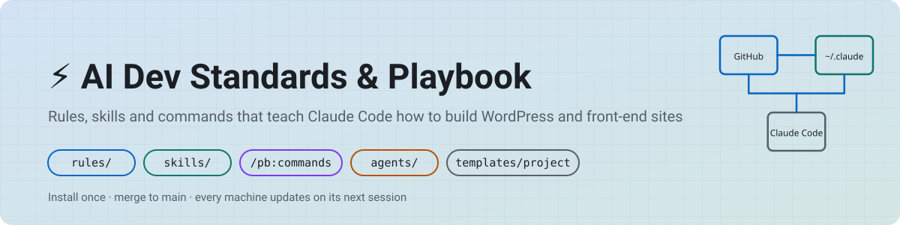
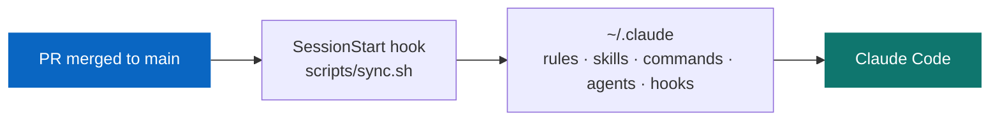
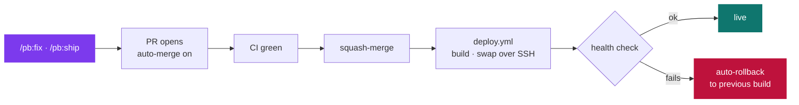
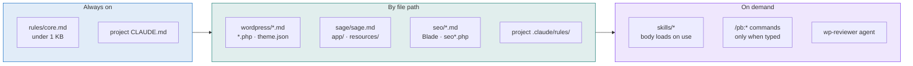

<a id="top"></a>
<p align="center">
  <picture>
    <source media="(prefers-color-scheme: dark)" srcset="docs/assets/banner-dark.svg">
    
  </picture>
</p>

<p align="center">
  <a href="https://github.com/matthummel-pa/ai-dev-standards-playbook/actions/workflows/validate.yml"></a>
  <a href="https://github.com/matthummel-pa/ai-dev-standards-playbook/actions/workflows/pages.yml"></a>
  <a href="VERSION"></a>
  <a href="#contribute"></a>
</p>

<p align="center">
  <a href="#why">Why</a> ·
  <a href="#inside">What's inside</a> ·
  <a href="#install">Install</a> ·
  <a href="#use">Daily use</a> ·
  <a href="#update">Auto-update</a> ·
  <a href="#loads">What loads when</a> ·
  <a href="#changes">What's new</a> ·
  <a href="#contribute">Change a rule</a> ·
  <a href="https://matthummel-pa.github.io/ai-dev-standards-playbook/">Docs site ↗</a>
</p>

---

**One repo that teaches Claude Code how I build WordPress and front-end projects, and keeps every machine in sync.**

Coding standards, SEO rules, writing voice, reference docs, slash commands, a reviewer agent and a drop-in deploy kit. Install once; every merge to `main` updates every Claude Code session automatically.

Maintained by [Matt Hummel](https://matthummel.com), full-stack & WordPress developer in Gettysburg, PA.

<a id="why"></a>
## 🎯 Why this exists

Every always-on instruction costs tokens in every session, and standards that live in one project don't follow you to the next. This repo fixes both.

| | |
| --- | --- |
| 📍 **One source of truth** | How work gets done — standards, security, SEO, voice — in one place, for every project. |
| 🪶 **Loads only what's needed** | One 0.9 KB core rule is always on. Everything else loads by file path or when a skill is used. |
| 🔁 **Auto-updates** | A SessionStart hook pulls `main` and re-installs on every new Claude Code session. |
| 🔓 **Public and generic** | No hosts, logins, client names or product data. Project facts stay in each project's `CLAUDE.md`. |



<a id="inside"></a>
## 📦 What's inside

| Area | What you get | Loads |
| --- | --- | --- |
| 📐 **Rules** `rules/` | `core.md` (always on, < 1 KB) · WordPress standards + review rules · Sage/Roots conventions · AI-search/GEO SEO | By file path |
| 🧠 **Skills** `skills/` | `doc-references` · `content-writer` · `growth-design` · `portfolio-seo` · `geo-blog-post` · `sage-architecture` | When Claude uses them |
| ⌨️ **Commands** `commands/pb/` | `/pb:new-project` · `/pb:plan` · `/pb:fix` · `/pb:review` · `/pb:ship` | When you type them |
| 🕵️ **Agent** `agents/` | `wp-reviewer` — senior WordPress/Sage review of a diff before a PR | On request / proactively |
| 🪝 **Hook** `hooks/` | `phpcs-on-edit.sh` — runs PHPCS on every PHP file Claude edits and feeds errors back | After every edit |
| 📁 **Project template** `templates/project/` | `CLAUDE.md`, `.claude/settings.json` (permissions + WebFetch allowlist), GitHub Actions deploy over SSH with health check and auto-rollback, setup scripts | Copied into each repo |
| 📖 **Guides** `playbook/` | Automated ship workflow · Token discipline · Rules architecture | Read by humans |
| 🛠 **Scripts** `scripts/` | `install.sh` · `sync.sh` · `new-project.sh` · `validate.py` · `build-docs.py` | Run by you / CI |
| 🌐 **Docs site** `docs/` | Generated from the live rules, skills, commands and agents → [matthummel-pa.github.io/ai-dev-standards-playbook](https://matthummel-pa.github.io/ai-dev-standards-playbook/) | On every merge |
| 🎙 **Voiceover Booth** `docs/booth/` | Teleprompter + coach for recording narration line by line: live pace and melody meters, script marking, countdown, take scoring, zip export → [/booth/](https://matthummel-pa.github.io/ai-dev-standards-playbook/booth/) | Open in Chrome |

<details>
<summary><strong>🧠 Skills at a glance</strong></summary>
<br>

| Skill | Use it when |
| --- | --- |
| `doc-references` | Before writing code against an API you haven't verified this session. Lists the official docs for WordPress, Roots/Bedrock, Tailwind, MDN, WHATWG, W3C/ARIA, web.dev, caniuse, TypeScript, React, Next.js, Node, NestJS and SEO, with a source-precedence rule. |
| `content-writer` | Writing or editing visitor-facing copy, posts and emails. Adds Editor's Notes when editing someone else's text. |
| `growth-design` | Landing pages, conversion copy, visual polish or a design review (marketer, graphic designer, web designer personas). |
| `portfolio-seo` | Writing or auditing portfolio, service or project pages. |
| `geo-blog-post` | Drafting a blog post for Google AI Overviews and LLM search (BLUF, E-E-A-T, FAQ, Article JSON-LD). |
| `sage-architecture` | Adding ACF fields in PHP, Customizer settings, dark-mode defaults, the Tailwind/theme.json token bridge, or deploy workflows. |

</details>

<details>
<summary><strong>⌨️ Commands at a glance</strong></summary>
<br>

| Command | What it does |
| --- | --- |
| `/pb:new-project [slug] [url]` | Copies the project template into the current repo without overwriting anything. |
| `/pb:plan <what>` | Plans a large change before coding. |
| `/pb:fix <what>` | Fixes a bug or makes a small change end to end, then ships it. |
| `/pb:review [PR]` | Senior WordPress/Sage review of the current branch or a PR. |
| `/pb:ship` | Runs checks, commits, pushes and opens a PR with auto-merge. |

</details>

<details>
<summary><strong>🗂 Repo layout</strong></summary>
<br>

```
rules/                 Path-scoped rules → ~/.claude/rules/playbook/
  core.md                the only always-on rule (< 1 KB)
  wordpress/             WordPress standards + review rules   (*.php, theme.json, block.json)
  sage/                  Sage/Roots conventions               (app/, resources/, vite.config.js)
  seo/                   AI-search / GEO standards            (Blade, seo*.php, *.mdx)
skills/                On-request skills → ~/.claude/skills/<name>/
commands/pb/           Slash commands → /pb:ship /pb:fix /pb:plan /pb:review /pb:new-project
agents/                Subagents (wp-reviewer)
hooks/                 Hook scripts (PHPCS on edit)
templates/project/     Drop-in kit: CLAUDE.md, settings, SSH deploy + rollback
playbook/              Guides: ship workflow, token discipline, rules architecture
docs/                  Docs site source (template + assets); index.html is built in CI
scripts/               install, sync, new-project, validate, build-docs
```

</details>

<a id="install"></a>
## 🚀 Install (2 minutes)

In Git Bash (Windows), WSL or macOS:

```bash
git clone https://github.com/matthummel-pa/ai-dev-standards-playbook.git ~/code/ai-dev-standards-playbook
bash ~/code/ai-dev-standards-playbook/scripts/install.sh
```

`install.sh` copies the playbook into `~/.claude` and adds one SessionStart hook to `~/.claude/settings.json` (backup kept at `settings.json.bak-playbook`). Copies, not symlinks, so it works on Windows without Developer Mode.

<a id="use"></a>
## 🛠 Daily use

```bash
cd ~/code/my-theme
claude
/pb:new-project my-theme https://example.com
```

Then `/pb:fix …` and `/pb:ship` for daily work.



Full loop in [`playbook/automated-ship-workflow.md`](playbook/automated-ship-workflow.md).

<a id="update"></a>
## 🔁 How auto-update works

1. Merge a change to `main`.
2. The next Claude Code session anywhere runs `scripts/sync.sh`: `git pull --ff-only`, then re-copies rules, skills, commands, agents and hooks into `~/.claude`.
3. Nothing changed → silent. Something changed → one line: `Playbook rules updated to abc1234 (…)`.

Rules load at session start, so a change shows up in the session **after** the one that pulled it. To apply now: `bash ~/code/ai-dev-standards-playbook/scripts/sync.sh`, then restart Claude Code.

<a id="loads"></a>
## 🪶 What loads when



| Layer | Where | Loads | Use for |
| --- | --- | --- | --- |
| Core rule | `~/.claude/rules/playbook/core.md` | Every session | 5–10 lines true everywhere |
| Path rules | `~/.claude/rules/playbook/**` with `paths:` | When a matching file is read or edited | Coding standards per file type |
| Skills | `~/.claude/skills/<name>/SKILL.md` | Description always; body on use | Long playbooks |
| Commands | `~/.claude/commands/pb/*.md` | When typed | Repeatable workflows |
| Project `CLAUDE.md` | Repo root | Every session in that repo | Project facts, commands, hard no's |
| Project rules | Repo `.claude/rules/` | By path in that repo | Private infra and product details |

**Rule of thumb:** true everywhere and one line → core · about a file type → path rule · a procedure → skill · triggered on purpose → command · names a host, path or client → the project repo, never here. Details in [`playbook/rules-architecture.md`](playbook/rules-architecture.md).

<a id="changes"></a>
## 🆕 What's new

Full history in [`CHANGELOG.md`](CHANGELOG.md).

| Version | Highlights |
| --- | --- |
| **1.3.0** | Voiceover Booth: a hosted teleprompter/coach for recording narration, with pro voice-over rules built in. |
| **1.2.1** | README redesign: banner, badges, section nav, mermaid diagrams, collapsible reference tables, footer. |
| **1.2.0** | GitHub Pages docs site generated from the live rules, skills, commands and agents (`scripts/build-docs.py`). |
| **1.1.0** | `doc-references` skill (canonical docs for the whole stack + verify-before-coding rule); `WebFetch` allowlist in the project `settings.json`. |
| **1.0.0** | Core + path rules, five skills, `/pb:*` commands, `wp-reviewer` agent, PHPCS hook, project template with SSH deploy and rollback, install/sync scripts, validation CI. |

<a id="contribute"></a>
## ✏️ Change a rule

1. Branch. Edit. Add a `CHANGELOG.md` line; bump `VERSION` if behavior changes.
2. Open a PR. `validate.yml` checks frontmatter, size budgets, private details and shell scripts.
3. Merge. Every machine picks it up on its next session, and the docs site rebuilds from the new frontmatter.

Preview the docs site locally: `python3 scripts/build-docs.py` then open `docs/index.html`.

### Public vs private

This repo is public and holds **generic** standards only. Hosts, paths, plugin names, logins and product catalogs live in each project's own `CLAUDE.md` and `.claude/rules/`. `scripts/validate.py` blocks obvious private details and secrets from landing here.

---

<p align="center">
  <a href="https://matthummel-pa.github.io/ai-dev-standards-playbook/">Docs site</a> ·
  <a href="CHANGELOG.md">Changelog</a> ·
  <a href="playbook/">Guides</a> ·
  <a href="https://github.com/matthummel-pa/ai-dev-standards-playbook/issues">Issues</a> ·
  <a href="https://matthummel.com">matthummel.com</a>
  <br><br>
  <sub>Built for <a href="https://claude.com/claude-code">Claude Code</a> · WordPress · Sage/Bedrock · Tailwind CSS v4 · GitHub Actions</sub>
  <br>
  <a href="#top">↑ Back to top</a>
</p>
